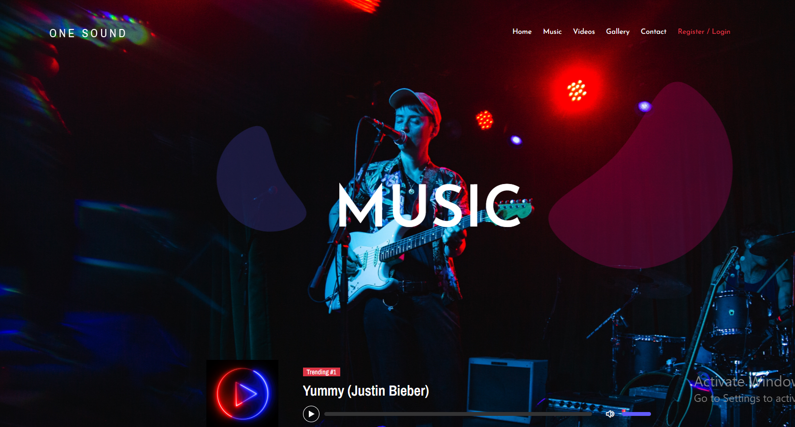
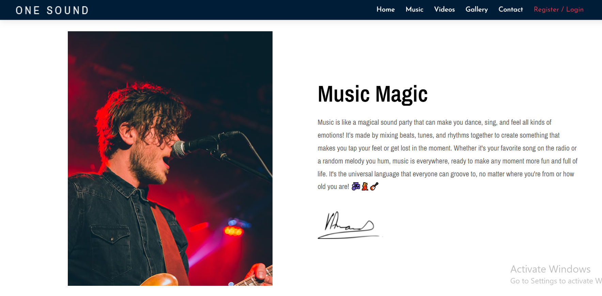
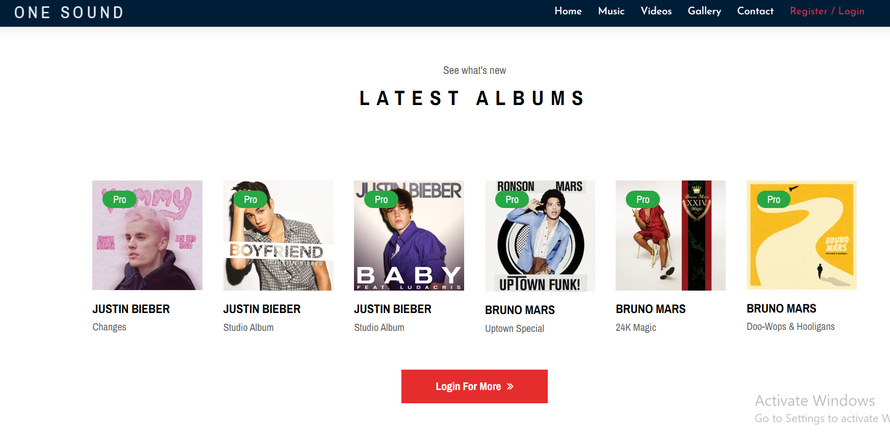
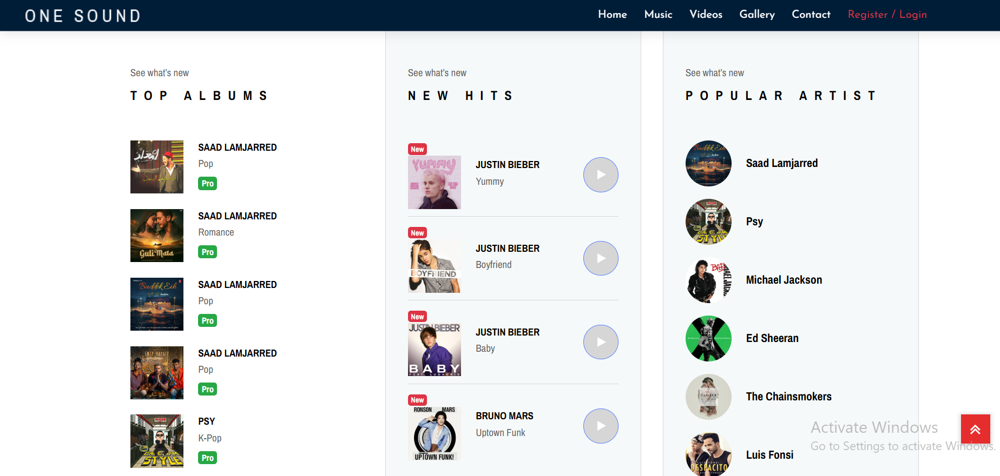

<h1 align="center">🎵 One Sound</h1>

<p align="center">
  <b>A responsive Core PHP and MySQL music and video platform with public homepage previews, secure authentication, an administration dashboard, media management, search, reviews, ratings, and contact-message workflows.</b>
</p>

<p align="center">
  
  
  
  
  
</p>

---

## 📸 Project Screenshots

| Home | About |
|---|---|
|  |  |

| Latest Albums | Collections |
|---|---|
|  |  |

---

## 🚀 Project Overview

**One Sound** is a complete educational media website built with **Core PHP, MySQL/MariaDB, HTML5, CSS3, Bootstrap, JavaScript, and jQuery**.

Visitors can open the homepage without signing in and immediately preview the latest songs, videos, albums, collections, and gallery content. Registration and login unlock the complete music, video, album, search, review, profile, and contact workflows. Administrators use a separate dashboard to manage users, categories, audio, video, and contact messages.

---

## 🎯 Key Highlights

- 🎧 Public playback for the homepage’s initially displayed audio previews
- 🎬 Public playback for the homepage’s initially displayed video previews
- 🔐 Authentication required for the complete music, video, and album libraries
- 👤 Secure registration, login, logout, profile update, and password update
- 🛡️ Fixed Administrator and User authorization roles
- 🧑‍💼 Administration dashboard for catalog and account management
- 🔍 Search and filtering by song, album, video, artist, genre, language, and year
- ⭐ One review and rating per user for each audio track
- 📩 Contact messages with administrator moderation
- 📁 Validated image, audio, and video uploads
- 🔒 CSRF protection, prepared statements, session regeneration, and rate limiting
- 🧪 PHPUnit tests, portable PHP linting, repository checks

---

## ✨ Features

### 🌐 Public Homepage Features

| Feature | Description |
|---|---|
| Homepage | View the complete landing-page layout without authentication |
| Trending Song | Listen to the latest ranked song directly from the homepage |
| Latest Music | Listen to the initially displayed audio previews |
| Latest Albums | View the initially displayed album cards |
| Latest Videos | Watch the initially displayed video previews |
| Collections | View top albums, new hits, and popular artists |
| Gallery | Browse the homepage image gallery |
| Restricted “More” Links | Sign-in is required for full audio, video, and album libraries |

### 👥 Authenticated User Features

| Feature | Description |
|---|---|
| Authentication | Create an account, sign in securely, and sign out through POST/CSRF protection |
| Music Library | Browse paginated songs and song details |
| Album Browsing | View albums and the songs assigned to each album |
| Video Library | Browse and play the complete video catalog |
| Search | Search audio, albums, and videos using bookmarkable GET requests |
| Reviews & Ratings | Add, update, and delete only your own reviews |
| Profile Management | Update profile information and profile image |
| Password Security | Change password only after confirming the current password |
| Contact | Submit contact messages to the administrator |

### 🧑‍💼 Administrator Features

| Feature | Description |
|---|---|
| Dashboard | View catalog, user, and message totals |
| User Management | Add, update, list, and safely remove users |
| Fixed Roles | View the Administrator and User roles supported by the application |
| Category Management | Manage artist, album, genre, language, year, and cover metadata |
| Music Management | Upload, update, search, list, and remove audio records |
| Video Management | Upload, update, search, list, and remove video records |
| Message Management | View, mark as read, and remove contact messages |
| Account Security | Update administrator profile and password securely |

---

## 🛠 Technologies

| Layer | Technologies |
|---|---|
| Backend | Core PHP 8.x, MySQLi, procedural modules and helpers |
| Database | MySQL / MariaDB with foreign keys, indexes, constraints, and transactions |
| Frontend | HTML5, CSS3, Bootstrap, JavaScript, jQuery |
| Media | HTML5 audio/video, byte-range streaming, private media storage |
| Authentication | PHP sessions, `password_hash()`, `password_verify()` |
| Security | Prepared statements, CSRF, authorization, escaping, validation, throttling |
| Testing | PHPUnit, portable PHP lint script, repository verification |

---

## 🏗 Folder Structure

```text
One Sound/
├── admin/                   # Administration pages and compiled admin assets
│   ├── uploads/images/      # Runtime catalog images
│   └── vendor/              # Required compiled administration dependencies
├── database/                # Fresh MySQL schema and fictional demo records
├── frontend/                # Public and authenticated user-facing pages
│   ├── partials/            # Shared homepage/header/footer components
│   └── media.php            # Controlled audio/video delivery endpoint
├── includes/                # Core PHP configuration, database, auth and validation helpers
├── scripts/                 # Migration, linting and repository-verification scripts
├── tests/                   # PHPUnit source and database integration tests
├── composer.json            # Development/test dependencies and scripts
├── composer.lock            # Reproducible Composer dependency versions
├── config.example.php       # Safe local-configuration example
├── LICENSE                  # MIT License
└── README.md                # Project documentation
```

---

## 🗄 Database Structure

Database file:

```text
database/sounds.sql
```

| Table | Purpose |
|---|---|
| `roles` | Stores the fixed Administrator and User roles |
| `users` | Stores accounts, profiles, status, and session-version information |
| `categories` | Stores album, artist, genre, language, year, and cover metadata |
| `audio` | Stores song titles, secure storage keys, MIME metadata, and category links |
| `videos` | Stores video titles, secure storage keys, MIME metadata, and category links |
| `review_audio` | Stores one review/rating per user and audio track |
| `messages` | Stores contact messages and read lifecycle data |
| `request_limits` | Stores database-backed request-throttling state |

---

## ⚙️ Installation

### Requirements

- Windows with XAMPP, or another Apache/PHP/MySQL environment
- PHP 8.2 or later with `mysqli`, `mysqlnd`, `fileinfo`, `mbstring`, `openssl`, XML and DOM extensions
- MySQL or MariaDB
- Composer for installing PHPUnit and running development checks

### Setup Steps

1. Clone or download the repository into XAMPP:

```powershell
git clone <your-repository-url> "C:\xampp\htdocs\One Sound"
Set-Location "C:\xampp\htdocs\One Sound"
```

2. Install the locked development dependencies:

```powershell
composer install --prefer-dist --no-interaction
```

3. Create the local configuration:

```powershell
Copy-Item .\config.example.php .\config.local.php
notepad .\config.local.php
```

Recommended local database settings:

```php
'database' => [
    'host' => '127.0.0.1',
    'port' => 3306,
    'name' => 'sounds',
    'user' => 'root',
    'password' => '',
],
```

4. Create the database named `sounds` and import:

```text
database/sounds.sql
```

5. Ensure the private media path configured in `config.local.php` exists, for example:

```text
C:\xampp\one-sound-private-media
```

6. Start Apache and MySQL through XAMPP.

7. Open the website:

```text
Public homepage: http://localhost/One%20Sound/frontend/home.php
User login:     http://localhost/One%20Sound/frontend/signin.php
Admin login:    http://localhost/One%20Sound/admin/login.php
```

### Existing Database Upgrade

For an older `sounds` database, create a backup and run once:

```powershell
php .\scripts\migrate.php
```

When the previous MP3/MP4 files are available only in an older project folder or ZIP archive, restore them into private storage with:

```powershell
powershell -ExecutionPolicy Bypass -File .\scripts\restore_private_media.ps1 `
    -OriginalSource "C:\path\to\One Sound(1).zip"
```

The restoration utility copies only media referenced by the existing database, stores it outside `htdocs`, updates the secure storage keys, and verifies public homepage audio/video range requests. It does not delete the source archive.

---

## 🔑 Fresh-Install Demo Credentials

### Administrator

```text
Email:    admin.demo@example.test
Password: AdminDemo123!
```

### User

```text
Email:    user.demo@example.test
Password: UserDemo123!
```

> Demo accounts are intended only for local evaluation. Change or remove them before any public deployment.

---

## ▶️ Usage

### Public Visitor

1. Open `frontend/home.php`.
2. Play the trending song and initially displayed audio/video previews.
3. View the initially displayed albums, collections, and gallery.
4. Select a “Login For More” button to sign in for the complete catalog.

### Registered User

1. Sign in through `frontend/signin.php`.
2. Browse all music, albums, videos, categories, and search pages.
3. Play media, manage your profile, and submit one review per song.
4. Send a contact message to the administrator.

### Administrator

1. Sign in through `admin/login.php`.
2. Manage users, categories, music, videos, messages, profile, and password.
3. Upload only media you own or are authorized to use.

---

## 🧪 Testing

Create the isolated test database from `database/sounds.sql`, then run:

```powershell
composer validate --strict --no-check-publish
composer audit --locked
php .\scripts\lint.php
php .\scripts\check_repository.php
php .\vendor\bin\phpunit --configuration .\phpunit.xml.dist
```

The complete suite should finish with no failures and no skipped database integration tests.

---

## 🔐 Security

The project includes:

- Prepared statements for request-driven database operations
- CSRF protection for state-changing requests
- Administrator and User authorization checks
- Session ID regeneration and global password-change session revocation
- Current-password verification
- Server-side validation and output escaping
- Database-backed request throttling
- Upload MIME, extension, size, filename, dimension, and signature validation
- Private media storage with controlled range-enabled delivery
- Database uniqueness, check constraints, indexes, and foreign keys
- Generic production error output and private error logging

---

## 👨‍💻 Author

**Muhammad Ali Nawaz**  
Core PHP Developer

---

## 📄 License

This project is open-sourced software licensed under the [MIT License](LICENSE).

---

<p align="center">
  <b>⭐ If you like this project, consider starring the repository!</b>
</p>