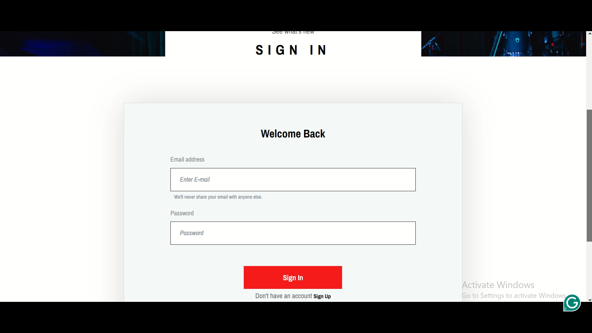
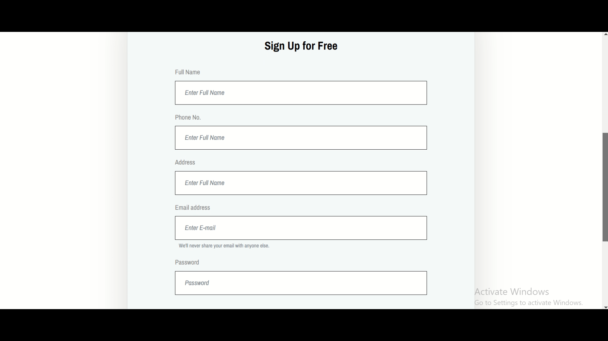
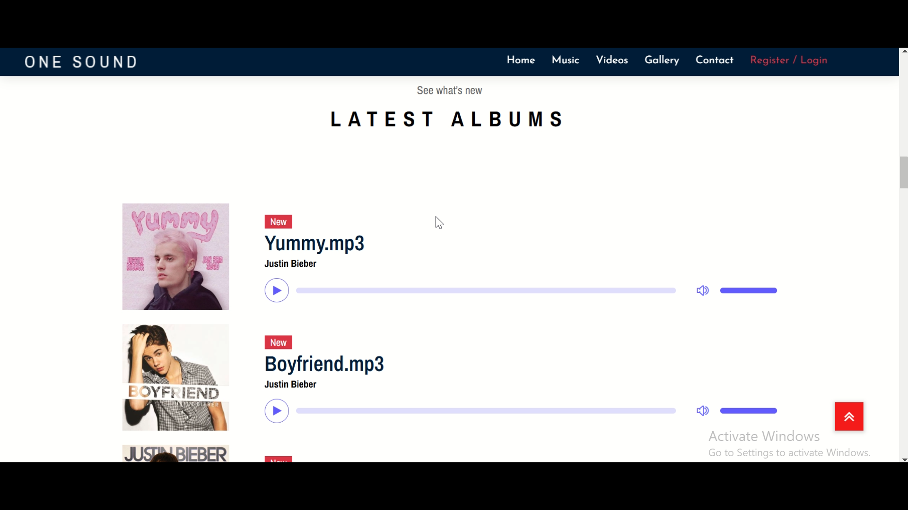
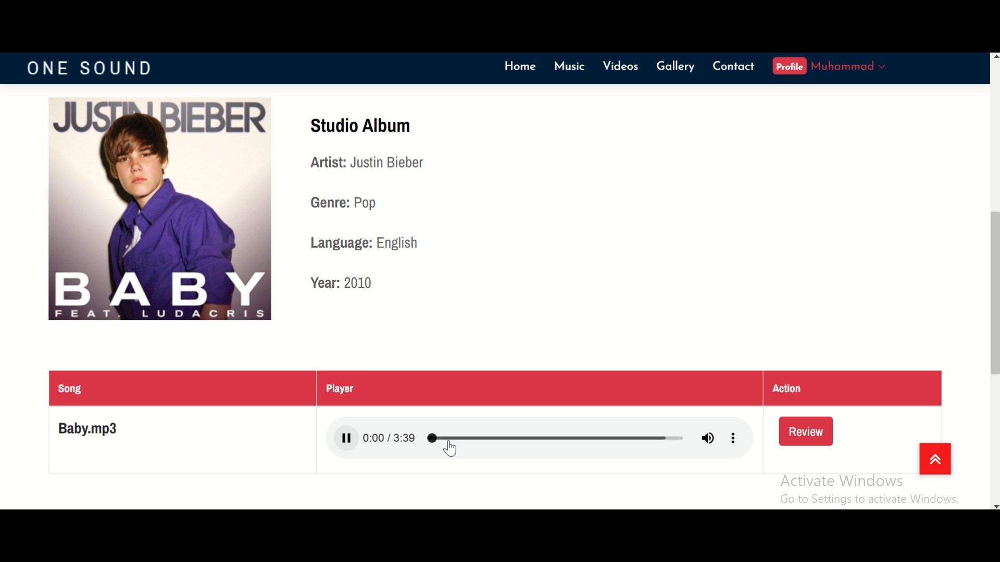
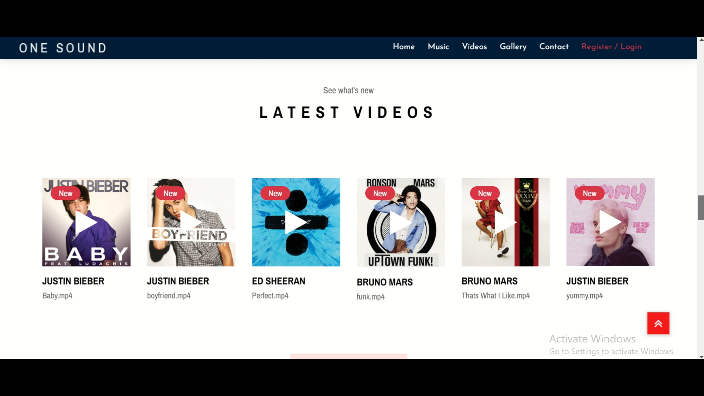
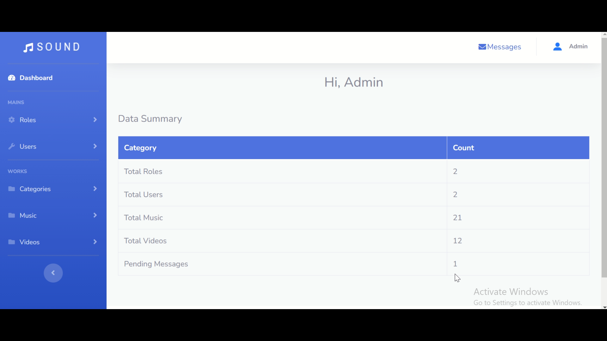
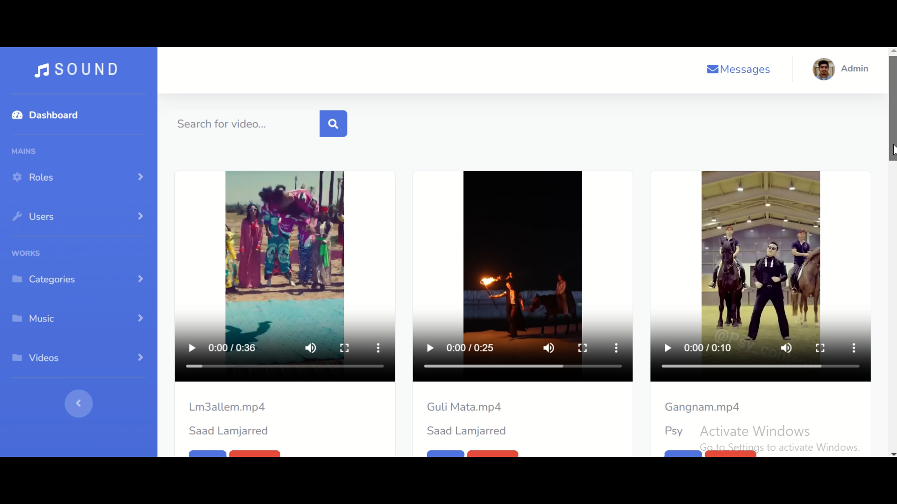

<h1 align="center">🎵 One Sound</h1>

<p align="center">
  <b>A full-stack PHP & MySQL music/video streaming platform with authentication, admin dashboard, media management, search, reviews, and contact workflows.</b>
</p>

<p align="center">
  
  
  
  
  
</p>

<p align="center">
  <b>Music Streaming</b> • <b>Video Gallery</b> • <b>Admin Panel</b> • <b>User Reviews</b> • <b>Media Uploads</b>
</p>

---

## 📸 Project Screenshots

> Add your real screenshots inside `docs/screenshots/` using the same filenames below.

| Login Page | Register Page |
|---|---|
|  |  |

| Homepage | Music Library |
|---|---|
|  |  |

| Song Detail & Reviews | Video Gallery |
|---|---|
|  |  |

| Admin Dashboard | Admin Media Management |
|---|---|
|  |  |

---

## 🚀 Project Overview

**One Sound** is a complete media streaming web application built with **Core PHP, MySQL, Bootstrap, JavaScript, and SB Admin 2**. It provides a user-facing platform where listeners can browse, search, play, and review music/videos, while administrators can manage the full content catalog from a dedicated dashboard.

This project demonstrates practical full-stack PHP development including authentication, role-based access flow, relational database design, media uploads, admin CRUD operations, dynamic search, and user-generated reviews.

---

## 🎯 Key Highlights

- 🎧 Music streaming with HTML5 audio playback  
- 🎬 Video listing and popup video playback  
- 👤 User registration, login, profile update, and password update  
- 🛡️ Separate admin and user login flows  
- 🧑‍💼 Admin dashboard for managing roles, users, categories, music, videos, and messages  
- 🔍 Search/filter system for songs, albums, videos, artists, genres, languages, and years  
- ⭐ Review and rating system for audio tracks  
- 📩 Contact form with pending/seen message management  
- 🗄️ Relational MySQL database with foreign-key relationships  
- 🎨 Responsive frontend and professional admin UI  

---

## ✨ Features

### 👥 User Features

| Feature | Description |
|---|---|
| Authentication | Users can sign up, sign in, and logout securely |
| Music Library | Browse songs with album, artist, genre, language, and year metadata |
| Audio Player | Play songs directly through browser-based audio controls |
| Album Browsing | Explore albums and view related songs |
| Video Gallery | Watch uploaded video content through popup/video playback |
| Search System | Search audio, albums, and videos by metadata |
| Reviews & Ratings | Add, edit, and delete personal song reviews |
| Profile Management | Update profile details, image, and password |
| Contact Form | Submit messages to the platform administrator |

### 🧑‍💼 Admin Features

| Feature | Description |
|---|---|
| Dashboard | View total roles, users, music, videos, and pending messages |
| Role Management | Add, view, edit, and delete user roles |
| User Management | Manage users and assign roles |
| Category Management | Add artist, album, genre, language, year, and cover image metadata |
| Music Management | Upload, edit, search, and delete music files |
| Video Management | Upload, edit, search, and delete video files |
| Message Management | View, mark as read, and delete contact messages |

---

## 🛠 Tech Stack

| Layer | Technologies |
|---|---|
| Backend | PHP, MySQLi |
| Database | MySQL / MariaDB |
| Frontend | HTML5, CSS3, Bootstrap, JavaScript, jQuery |
| Admin UI | SB Admin 2, Bootstrap, Font Awesome |
| Media | HTML5 Audio, HTML5 Video, local upload storage |
| Authentication | PHP Sessions, `password_hash()`, `password_verify()` |
| UI Libraries | Owl Carousel, Magnific Popup, SlickNav, WOW.js, Animate.css |

---

## 🏗 Architecture Overview

The project follows a custom PHP modular structure with separate areas for the public frontend and admin dashboard.

```text
One Sound/
├── admin/              # Admin dashboard, CRUD modules, uploads, admin assets
├── frontend/           # User-facing music/video platform
├── database/           # MySQL database dump
└── readme.txt          # Original basic project note
```

### Application Flow

```text
User Registration/Login
        ↓
Browse Music / Albums / Videos
        ↓
Search or Filter Media
        ↓
Play Audio / Watch Video
        ↓
Submit Review or Contact Message
```

```text
Admin Login
        ↓
Dashboard Overview
        ↓
Manage Categories
        ↓
Upload Music & Videos
        ↓
Manage Users, Roles & Messages
```

---

## 🗄 Database Structure

Database file:

```text
database/sounds.sql
```

Main tables:

| Table | Purpose |
|---|---|
| `roles` | Stores `Administrator` and `User` role types |
| `users` | Stores user/admin accounts and profile details |
| `categories` | Stores artist, album, genre, language, year, and cover image |
| `audio` | Stores uploaded music records linked to categories |
| `videos` | Stores uploaded video records linked to categories |
| `review_audio` | Stores reviews and ratings for songs |
| `messages` | Stores contact form submissions with pending/seen status |

### Core Relationships

| Relationship | Description |
|---|---|
| `users.role_id → roles.role_id` | Connects each account to a role |
| `audio.category_id → categories.category_id` | Links each song to album/artist metadata |
| `videos.category_id → categories.category_id` | Links each video to album/artist metadata |
| `review_audio.audio_id` | Connects reviews to audio tracks |
| `review_audio.user_id` | Connects reviews to users |

---

## 🔐 Security Implementations

| Security Area | Implementation |
|---|---|
| Password Security | Passwords are hashed using `password_hash()` |
| Login Verification | Passwords are checked using `password_verify()` |
| Session Protection | Protected pages use PHP session validation |
| Role Flow | Admin and user login flows are separated by `role_id` |
| Output Escaping | Several admin/message views use `htmlspecialchars()` |
| Review Ownership | Users can edit/delete only their own reviews |
| Message Status Control | Contact messages use controlled `pending` / `seen` status |

> Recommended production improvements: prepared statements across all queries, CSRF tokens, stricter admin middleware, MIME/type validation for uploads, pagination, and environment-based database configuration.

---

## ⚡ Performance & Code Quality

- Uses SQL joins to combine media records with category metadata
- Dashboard uses SQL count queries for quick admin summaries
- Latest content sections use ordered queries and limits
- Reusable `header.php` and `footer.php` files reduce duplicated layout code
- Static assets are organized separately for admin and frontend
- Media files are stored in dedicated upload directories
- Database uses primary keys and foreign keys for main relationships

---

## 📡 API / Routes

This project does not include a REST API. It uses traditional PHP page endpoints and form submissions.

| Endpoint | Purpose |
|---|---|
| `frontend/signup.php` | User registration |
| `frontend/signin.php` | User login |
| `frontend/music.php` | Music listing |
| `frontend/detail.php` | Song detail and reviews |
| `frontend/video.php` | Video gallery |
| `frontend/contact.php` | Contact message submission |
| `admin/login.php` | Admin login |
| `admin/index.php` | Admin dashboard |
| `admin/add_music.php` | Upload music |
| `admin/add_video.php` | Upload video |
| `admin/message.php` | Manage contact messages |

---

## ⚙️ Installation Guide

### Requirements

- PHP 8.x
- MySQL / MariaDB
- Apache server
- XAMPP, WAMP, Laragon, or similar local environment
- phpMyAdmin recommended

### Setup Steps

1. Clone or download the repository.

```bash
git clone https://github.com/your-username/one-sound.git
```

2. Move the project folder into your local server directory.

```text
xampp/htdocs/One Sound
```

3. Start Apache and MySQL.

4. Create a database named:

```sql
sounds
```

5. Import the database file:

```text
database/sounds.sql
```

6. Update database credentials if required:

```text
admin/database.php
frontend/database.php
```

Default local configuration:

```php
$servername = "localhost";
$username = "root";
$password = "";
$dbname = "sounds";
```

7. Open the project in your browser.

```text
Frontend: http://localhost/One%20Sound/frontend/home.php
Admin:    http://localhost/One%20Sound/admin/login.php
```

---

## 🔑 Demo Credentials

### Admin

```text
Email: admin@admin.com
Password: admin
```

### User

```text
Email: ali@ali.com
Password: ali
```

> Demo credentials are for local testing only. Change them before deploying the project.

---

## 📁 Important Folder Structure

```text
admin/
├── add_music.php
├── add_video.php
├── view_music.php
├── view_video.php
├── view_user.php
├── view_role.php
├── message.php
├── uploads/
│   ├── images/
│   ├── music/
│   └── videos/
└── database.php

frontend/
├── home.php
├── signin.php
├── signup.php
├── music.php
├── album.php
├── video.php
├── detail.php
├── review_audio.php
├── profile.php
├── contact.php
└── database.php

database/
└── sounds.sql
```

---

## 🧪 Testing Checklist

- [ ] Import database successfully  
- [ ] Login as admin  
- [ ] Add category metadata  
- [ ] Upload music file  
- [ ] Upload video file  
- [ ] View dashboard counts  
- [ ] Register a new user  
- [ ] Login as user  
- [ ] Browse music and videos  
- [ ] Search songs/albums/videos  
- [ ] Submit song review  
- [ ] Edit/delete own review  
- [ ] Submit contact message  
- [ ] Mark message as read from admin panel  

---

## 🔮 Future Improvements

- Convert raw SQL queries to prepared statements
- Add CSRF protection for forms and delete actions
- Add stronger admin-only authorization middleware
- Add upload validation for file type, MIME type, and size
- Add pagination for large media lists
- Add playlists and favorite songs
- Add REST API for future mobile/frontend clients
- Add Docker setup and deployment documentation
- Add automated tests for authentication and CRUD workflows
- Migrate to Laravel MVC structure for larger-scale maintainability

---

## 👨‍💻 Author

**Muhammad Ali Nawaz**  
Full-Stack PHP Developer

Built as a portfolio project to demonstrate practical PHP/MySQL development, admin dashboard workflows, authentication, media management, relational database design, and user-facing web application features.

---

<p align="center">
  <b>⭐ If you like this project, consider starring the repository!</b>
</p>
